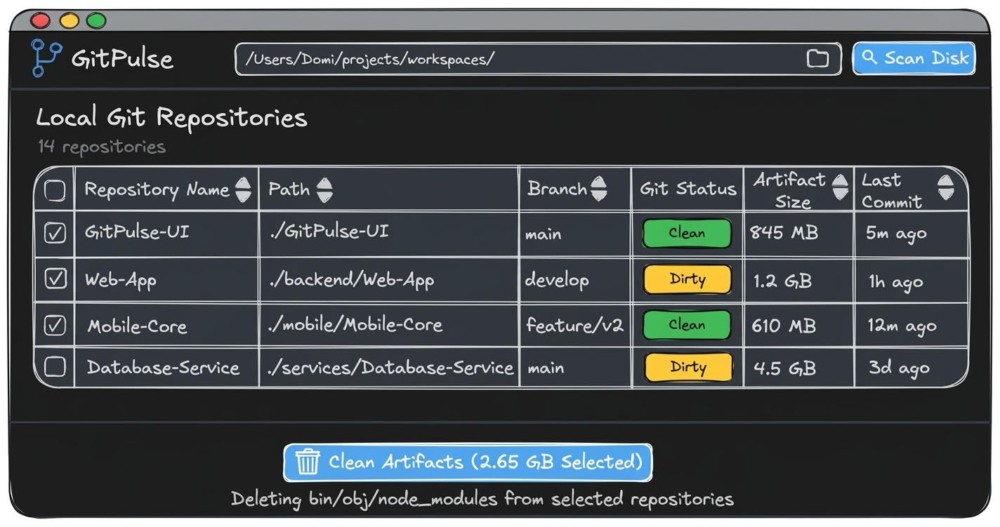
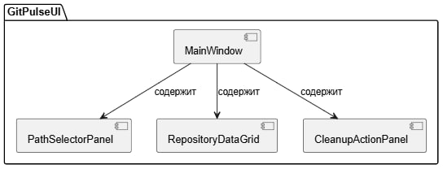

# Спецификация требований к ПО

Для GitPulse — кроссплатформенной десктопной утилиты аудита Git-репозиториев и очистки сборочных артефактов

Версия 0.1

Подготовил: Толкач Д. Г.

Группа: 450504, Вариант: 25

Белорусский государственный университет информатики и радиоэлектроники (БГУИР)

Дата изменения: 26 октября 2026 г.

## Оглавление

<!-- TOC -->
* [1. Введение](#1-introduction)
  * [1.1 Назначение документа](#11-document-purpose)
  * [1.2 Область применения продукта](#12-product-scope)
  * [1.3 Определения, акронимы и сокращения](#13-definitions-acronyms-and-abbreviations)
  * [1.4 Ссылки](#14-references)
  * [1.5 Обзор документа](#15-document-overview)
* [2. Обзор продукта](#2-product-overview)
  * [2.1 Перспектива продукта](#21-product-perspective)
  * [2.2 Функции продукта](#22-product-functions)
  * [2.3 Ограничения продукта](#23-product-constraints)
  * [2.4 Характеристики пользователей](#24-user-characteristics)
  * [2.5 Допущения и зависимости](#25-assumptions-and-dependencies)
  * [2.6 Распределение требований](#26-apportioning-of-requirements)
* [3. Требования](#3-requirements)
  * [3.1 Внешние интерфейсы](#31-external-interfaces)
    * [3.1.1 Пользовательские интерфейсы](#311-user-interfaces)
    * [3.1.2 Аппаратные интерфейсы](#312-hardware-interfaces)
    * [3.1.3 Программные интерфейсы](#313-software-interfaces)
  * [3.2 Функциональные требования](#32-functional)
  * [3.3 Качество обслуживания](#33-quality-of-service)
    * [3.3.1 Производительность](#331-performance)
    * [3.3.2 Безопасность](#332-security)
    * [3.3.3 Надёжность](#333-reliability)
    * [3.3.4 Доступность](#334-availability)
    * [3.3.5 Наблюдаемость](#335-observability)
  * [3.4 Соответствие стандартам](#34-compliance)
  * [3.5 Проектирование и реализация](#35-design-and-implementation)
    * [3.5.1 Установка](#351-installation)
    * [3.5.2 Сборка и поставка](#352-build-and-delivery)
    * [3.5.3 Распределение](#353-distribution)
    * [3.5.4 Сопровождаемость](#354-maintainability)
    * [3.5.5 Повторное использование](#355-reusability)
    * [3.5.6 Переносимость](#356-portability)
    * [3.5.7 Стоимость](#357-cost)
    * [3.5.8 Сроки](#358-deadline)
    * [3.5.9 Доказательство концепции](#359-proof-of-concept)
    * [3.5.10 Управление изменениями](#3510-change-management)
  * [3.6 ИИ/МО](#36-aiml)
* [4. Верификация](#4-verification)
* [5. Приложения](#5-appendixes)
<!-- TOC -->

## История изменений

| Name | Date | Reason For Changes | Version |
|:---|:---|:---|:---|
| Толкач Д. Г. | 26.10.2026 | Инициализация спецификации бизнес-требований<br>к утилите GitPulse в рамках лабораторной работы №3 по ЖЦРПО | 0.1 |

---

## 1. Введение {#1-introduction}

Настоящий документ представляет собой спецификацию требований к программному обеспечению (SRS) для кроссплатформенной десктопной утилиты GitPulse (версия 0.1). Продукт предназначен для автоматизированного аудита локальных репозиториев Git и очистки дискового пространства от временных сборочных артефактов. Документ определяет функциональные и качественные границы системы для использования при проектировании, разработке и верификации в рамках учебного курса.

### 1.1 Назначение документа {#11-document-purpose}

Настоящий SRS носит закрепительный характер и определяет полный комплект требований к поведению, возможностям и показателям качества утилиты GitPulse. Документ служит технической основой между разработчиком и проверяющей стороной (Заказчиком / преподавателем) на всех этапах жизненного цикла. Документ описывает поведение системы на уровне внешних интерфейсов («что» система делает) и условия её приемки.

### 1.2 Область применения продукта {#12-product-scope}

Утилита GitPulse — это автономное десктопное приложение, созданное для решения проблемы нехватки свободного места на накопителях разработчиков из-за накопления неиспользуемых сборочных файлов и временных директорий.

**В область применения продукта входит:**
- Сканирование указанных пользователем локальных директорий на предмет наличия вложенных Git-репозиториев.
- Сбор и табличное отображение метаданных репозиториев: наименование, относительный путь, активная ветка, статус рабочей копии (`Clean` / `Dirty`).
- Динамическое определение типа проекта и расчет объема временных сборочных артефактов для экосистем C, C++, Java, C# и Node.js (`bin/`, `obj/`, `target/`, `build/`, `cmake-build-debug/`, `node_modules/`).
- Выборочная или пакетная безопасная очистка папок артефактов для выбранных проектов.

**В область применения НЕ входит:**
- Удаление нефиксированных файлов исходного кода или работа с пользовательскими данными вне стандартных папок компиляции.
- Удаление системных временных файлов операционной системы.
- Управление удаленными репозиториями (GitHub/GitLab API, операции push/pull).

### 1.3 Определения, акронимы и сокращения {#13-definitions-acronyms-and-abbreviations}

| Термин / Аббревиатура | Определение |
|:---|:---|
| Сборочные артефакты | Временные каталоги и результаты компиляции (`bin`, `obj`, `node_modules`), генерируемые инструментами сборки. |
| Репозиторий Git | Каталог под управлением системы контроля версий Git, содержащий служебную папку `.git`. |
| Рабочая копия (Working Tree) | Состояние файлов проекта на диске. Статус Clean указывает на отсутствие незафиксированных изменений, Dirty — на наличие незакоммиченных данных. |
| SRS | Software Requirements Specification — спецификация требований к ПО. |
| SysMLv2 | Systems Modeling Language v2 — язык системного моделирования для спецификации и проектирования систем. |

### 1.4 Ссылки {#14-references}

1. Методические указания по дисциплине «Жизненный цикл разработки программного обеспечения» для студентов специальности «Компьютерная инженерия». Минск, БГУИР. [Нормативная ссылка]
2. СТП 01–2024 «Дипломные проекты (работы). Общие требования». Минск, БГУИР, 2024. [Нормативная ссылка]
3. Официальная документация распределенной системы контроля версий Git (https://git-scm.com/doc). [Справочная ссылка]
4. Спецификация платформы Avalonia UI (https://docs.avaloniaui.net/). [Справочная ссылка]

### 1.5 Обзор документа {#15-document-overview}

Раздел 1 содержит введение и описывает границы продукта. Раздел 2 задает контекст функционирования утилиты и характеристики пользователей. Раздел 3 специфицирует верифицируемые функциональные и нефункциональные требования с уникальными идентификаторами. Раздел 4 содержит матрицу трассируемости и верификации, а в Разделе 5 приведены графический мокап и SysMLv2-описание интерфейса.

---

## 2. Обзор продукта {#2-product-overview}

### 2.1 Перспектива продукта {#21-product-perspective}

GitPulse разрабатывается как полностью самостоятельный кроссплатформенный инструмент, не требующий интеграции с коммерческими облачными экосистемами или тяжелыми IDE. Утилита функционирует локально на стороне пользователя, взаимодействуя с установленной в операционной системе распределенной системой контроля версий через низкоуровневые интерфейсы Git CLI или библиотеки прямого чтения метаданных `.git`. Продукт нацелен на заполнение ниши легковесных утилит «все в одном» для обслуживания дискового пространства инженеров-программистов.

### 2.2 Функции продукта {#22-product-functions}

На основе спроектированного интерфейса система предоставляет следующие ключевые возможности:
- **Выбор целевой директории:** Указание произвольного пути на диске с помощью текстового ввода или диалогового окна ОС для глубокого сканирования.
- **Поиск репозиториев (Scan Disk):** Автоматическое сканирование дерева каталогов и обнаружение всех инициализированных Git-проектов.
- **Табличный аудит состояния:** Вывод агрегированной информации по каждому найденному репозиторию (имя, путь, ветка, статус `Clean`/`Dirty`, размер артефактов, дата коммита).
- **Управление выбором:** Возможность пакетного выбора репозиториев через чекбоксы для групповой обработки.
- **Информационный индикатор:** Отображение точного суммарного объема данных, готового к высвобождению (например, *"2.65 GB Selected"*).
- **Безопасная очистка (Clean Artifacts):** Безвозвратное удаление целевых директорий (`bin/`, `obj/`, `node_modules/`) для выбранных элементов таблицы при условии безопасности их данных.

### 2.3 Ограничения продукта {#23-product-constraints}

- **Кроссплатформенность:** Продукт должен бесшовно работать и иметь идентичный интерфейс в операционных системах семейств Windows, macOS и Linux.
- **Технологический стек:** В качестве основного языка разработки должен использоваться C#.
- **Зависимости окружения:** Для корректной работы утилиты в операционной системе пользователя должен быть установлен Git версии не ниже 2.40.
- **Права доступа:** Утилита ограничена правами текущего пользователя ОС. Она не должна пытаться модифицировать или сканировать системные защищенные каталоги, требующие привилегий администратора (root).
- **Поддерживаемые операционные системы:** Утилита функционирует кроссплатформенно и поддерживает ОС Windows 10/11, Linux (Ubuntu, Fedora) и macOS (12+).
- **Ограничения по кэшу:** Информирование пользователя о превышении лимита сборочного мусора срабатывает при достижении порогового значения в 500 МБ.

### 2.4 Характеристики пользователей {#24-user-characteristics}

Основной целевой аудиторией GitPulse являются:
- **Разработчики программного обеспечения:** Профессионалы и студенты, активно работающие с большим количеством локальных проектов параллельно. Обладают высокой компьютерной грамотностью, используют утилиту регулярно (раз в несколько дней/недель) для поддержания чистоты на накопителях (SSD/HDD).
- **DevOps-инженеры и QA:** Специалисты, развертывающие локальные сборочные окружения. 

Особых требований к доступности (Accessibility) интерфейса не предъявляется, так как аудитория является технически квалифицированной, однако интерфейс должен поддерживать стандартное масштабирование шрифтов ОС.

### 2.5 Допущения и зависимости {#25-assumptions-and-dependencies}

- **Допущение о структуре артефактов:** Система предполагает, что сборочные артефакты располагаются в стандартных для конкретных фреймворков директориях (например, для .NET проектов это `bin/` и `obj/`, для Node.js — `node_modules/`). Если пользователь вручную переопределил пути вывода компиляции в нестандартные места, утилита может их не обнаружить в рамках базового сканирования.
- **Зависимость от стабильности ФС:** Корректность подсчета размера артефактов напрямую зависит от стабильности работы файловой системы. В процессе сканирования сторонние процессы (например, запущенная компиляция в IDE или индексация антивируса) могут временно блокировать доступ к файлам.

### 2.6 Распределение требований {#26-apportioning-of-requirements}

Разработка разделена на следующие фазы:
- **Фаза 1 (5 семестр, 2026 г.):** Анализ предметной области, выявление бизнес-требований (SRS), создание мокапов, объектно-ориентированное и системное проектирование (SysMLv2/UML). Программный код на этом этапе не создается.
- **Фаза 2 (6 семестр, 2027 г.):** Разработка программного обеспечения, реализация модулей сканирования, интеграция с Git CLI, тестирование и стабилизация продукта.
- **Отложено на будущие итерации:** Расширение функционала под пользовательские плагины очистки и глубокая оптимизация под файловые системы сетевых хранилищ.

---

## 3. Требования {#3-requirements}

Этот раздел специфицирует верифицируемые требования к ПО для обеспечения проектирования и тестирования утилиты GitPulse.

### 3.1 Внешние интерфейсы {#31-external-interfaces}

#### 3.1.1 Пользовательские интерфейсы {#311-user-interfaces}

Пользовательский интерфейс представляет собой главное однооконное десктопное приложение, спроектированное на базе фреймворка Avalonia UI. Эскиз графического интерфейса вынесен в Приложение А.

**Структурная спецификация интерфейса на языке SysMLv2:**

```sysml
package GitPulseUI {
    public part def MainWindow {
        part headerBar : PathSelectorPanel;
        part statusSummary : ScanStatusPanel;
        part repositoryTable : RepositoryDataGrid;
        part actionPanel : CleanupActionPanel;
    }

    part def PathSelectorPanel {
        attribute pathInput : String;
        part browseButton : Button [1] { attribute label = "FolderIcon"; }
        part scanButton : Button [1] { attribute label = "Scan Disk"; }
    }

    part def RepositoryDataGrid {
        part selectAllCheckbox : CheckBox;
        part rows : RepositoryRow [*];
    }

    part def RepositoryRow {
        attribute isSelected : Boolean;
        attribute repoName : String;
        attribute relativePath : String;
        attribute activeBranch : String;
        attribute gitStatus : String; // "Clean" | "Dirty"
        attribute artifactSize : String;
        attribute lastCommit : String;
    }

    part def CleanupActionPanel {
        part cleanButton : Button [1] { attribute label = "Clean Artifacts"; }
        attribute selectedSizeText : String;
    }
}
```

**Описание элементов управления и поведения интерфейса:**
- **Поле пути и кнопка со значком папки:** Поле текстового ввода текущего каталога и кнопка вызова стандартного диалога выбора папки ОС. Разделители путей автоматически нормализуются под конкретную операционную систему (`/` или `\`).
- **Кнопка «Scan Disk»:** Элемент инициализации фонового рекурсивного сканирования структуры диска.
- **Таблица DataGrid:** Главный компонент вывода найденных проектов, содержащий 6 колонок (`Repository Name`, `Path`, `Branch`, `Git Status`, `Artifact Size`, `Last Commit`) с поддержкой сортировки (`↕`).
- **Индикатор состояния и кнопка «Clean Artifacts»:** Нижняя панель управления, отображающая динамически рассчитываемый объем выбранных данных (например, `2.65 GB Selected`) и запускающая процедуру очистки.

#### 3.1.2 Аппаратные интерфейсы {#312-hardware-interfaces}

Прямого взаимодействия с кастомными аппаратными интерфейсами утилита не осуществляет. Система взаимодействует со стандартными устройствами хранения данных (HDD/SSD накопители) через вызовы файловой системы операционной системы, обеспечиваемые средой выполнения .NET Runtime.

#### 3.1.3 Программные интерфейсы {#313-software-interfaces}

Утилита интегрируется со следующим системным программным обеспечением:
- **Операционная система (Windows / macOS / Linux):** Использование стандартного API для обхода дерева каталогов, чтения метаданных файлов, вычисления размера объектов файловой системы и выполнения процедур удаления папок.
- **Git CLI (версии >= 2.40):** Взаимодействие осуществляется посредством создания дочерних процессов (`System.Diagnostics.Process`) и выполнения консольных команд с последующим перенаправлением и парсингом стандартного вывода (stdout/stderr).

---

### 3.2 Функциональные требования {#32-functional}

#### 3.2.1 Модуль сканирования и аудита репозиториев

- **ID:** REQ-FUNC-001-01
- **Title:** Рекурсивный поиск репозиториев и вложенных подмодулей
- **Statement:** Система должна запускать рекурсивный поиск каталогов, содержащих признаки Git-репозитория (скрытая папка `.git` или файл конфигурации подмодуля `.git`), обрабатывая и выводя вложенные Git Submodules в общую таблицу аудита как самостоятельные репозитории.
- **Rationale:** Подмодули являются независимыми проектами со своими сборочными артефактами. Их вывод отдельными строками позволяет пользователю гибко управлять очисткой диска на любом уровне вложенности проектов.
- **Acceptance Criteria:** При сканировании корневой папки разработки утилита находит как основные проекты, так и проекты, подключенные как submodules, корректно отображая их пути и извлекая метаданные веток.
- **Verification Method:** Demonstration

- **ID:** REQ-FUNC-002-01
- **Title:** Извлечение и вывод метаданных Git-репозитория
- **Statement:** Для каждого обнаруженного репозитория система должна выполнить консольные запросы `git branch --show-current` (для определения активной ветки) и `git status --porcelain` (для определения чистоты рабочей копии) и вывести результаты в соответствующие столбцы таблицы интерфейса.
- **Rationale:** Пользователь должен видеть актуальный контекст разработки репозитория, чтобы случайно не запустить очистку в критически важных ветках или проектах с незафиксированным кодом.
- **Acceptance Criteria:** Если команда `git status --porcelain` возвращает пустой ответ, в столбце «Status» выводится значение `Clean`. Если возвращаются измененные или неотслеживаемые файлы — выводится значение `Dirty`.
- **Verification Method:** Test

- **ID:** REQ-FUNC-003-01
- **Title:** Динамическое определение типа проекта и расчет размера артефактов
- **Statement:** Система должна динамически определять тип проекта в обнаруженном репозитории путем поиска конфигурационных файлов (`.csproj` для C#, `package.json` для Node.js, `pom.xml` / `build.gradle` для Java, `CMakeLists.txt` или файлы Makefile для C/C++) и производить рекурсивный подсчет объема только тех папок артефактов, которые соответствуют выявленной экосистеме (`bin/obj`, `node_modules`, `target`, `build`, `cmake-build-debug`).
- **Rationale:** Обеспечение универсальности утилиты для поддержки основных языков программирования (C, C++, Java, C#, Node.js), используемых в учебной и рабочей практике разработчика.
- **Acceptance Criteria:** При сканировании репозитория система распознает конфигурационный файл проекта и рассчитывает объем строго соответствующих ему сборочных директорий. Итоговый размер выводится в столбце «Artifact Size» с округлением до двух знаков.
- **Verification Method:** Test

#### 3.2.2 Модуль управления выбором и пакетной очистки

- **ID:** REQ-FUNC-004-01
- **Title:** Агрегации объема выбранных данных
- **Statement:** Система должна динамически пересчитывать сумму значений столбца «Artifact Size» для всех строк таблицы, в которых пользователь установил флаг (чекбокс) выбора, и обновлять текстовый маркер в строке состояния.
- **Rationale:** Дает пользователю наглядную информацию о том, какой объем памяти будет освобожден на накопителе непосредственно перед выполнением необратимого удаления.
- **Acceptance Criteria:** Любое изменение состояния чекбокса в строке таблицы (установка или снятие флага) должно мгновенно приводить к изменению значения в строке состояния (например, *"X.XX GB Selected"*).
- **Verification Method:** Demonstration

- **ID:** REQ-FUNC-005-01
- **Title:** Блокировка удаления артефактов в измененных репозиториях
- **Statement:** Система должна аппаратно блокировать (делать недоступным для установки) чекбокс выбора строки и выводить предупреждающую иконку, если статус репозитория определен как `Dirty`.
- **Rationale:** Защита от потери данных. Пользователь не должен иметь возможности случайно очистить сборочные зависимости или временные файлы проекта, в котором есть незакоммиченные рабочие изменения, до тех пор, пока код не будет зафиксирован (Commit) или спрятан (Stash).
- **Acceptance Criteria:** Строки со статусом `Dirty` недоступны для выбора чекбоксом. При попытке общего выделения через флаг «Выбрать все» строки со статусом `Dirty` остаются пропущенными.
- **Verification Method:** Test

- **ID:** REQ-FUNC-006-01
- **Title:** Пакетная очистка артефактов и информирование о результатах
- **Statement:** При нажатии кнопки «Clean Artifacts» система должна запустить процесс удаления папок артефактов во всех выбранных репозиториях. В случае обнаружения заблокированных процессов или файлов, система должна завершить очистку доступных объектов, а после операции отобразить информационное окно со списком пропущенных репозиториев/файлов.
- **Rationale:** Обеспечение непрерывности пакетных операций без прерывания всего процесса из-за одной запущенной IDE.
- **Acceptance Criteria:** После удаления на экран выводится диалоговое окно. Если все файлы удалены успешно — окно подтверждает полную очистку. Если часть файлов заблокирована процессами (например, открыта в Rider/VS), окно выводит список пропущенных путей с рекомендацией закрыть связанные программы.
- **Verification Method:** Demonstration

---

### 3.3 Качество обслуживания {#33-quality-of-service}

#### 3.3.1 Производительность {#331-performance}

- **ID:** REQ-PERF-001-01
- **Title:** Скорость рекурсивного сканирования диска
- **Statement:** Время выполнения поиска репозиториев и расчета размера артефактов не должно превышать 30 секунд для дерева каталогов, содержащего до 50 000 папок и файлов на SSD-накопителе.
- **Rationale:** Низкая скорость работы утилиты приведет к ухудшению пользовательского опыта и зависанию графического интерфейса.
- **Acceptance Criteria:** Поиск по стандартной директории разработки пользователя укладывается в 30 секунд.
- **Verification Method:** Test

- **ID:** REQ-PERF-002-01
- **Title:** Асинхронное выполнение потоков файловых операций
- **Statement:** Операции сканирования файловой системы и удаления папок артефактов должны выполняться в фоновых асинхронных потоках, не блокируя основной поток отрисовки графического интерфейса (UI Thread).
- **Rationale:** Блокировка интерфейса приводит к появлению статуса ОС «Приложение не отвечает» и мешает отслеживать прогресс работы.
- **Acceptance Criteria:** Во время сканирования и очистки пользователь может свободно перемещать окно приложения по экрану, а анимация выполнения (Spinner) работает стабильно без фризов.
- **Verification Method:** Demonstration

#### 3.3.2 Безопасность {#332-security}

- **ID:** REQ-SEC-001-01
- **Title:** Изоляция файловых операций удаления
- **Statement:** Система должна выполнять безвозвратное удаление каталогов строго в границах определенных папок артефактов (`bin`, `obj`, `node_modules`), находящихся на одном уровне вложенности со скрытой папкой `.git` обнаруженного проекта.
- **Rationale:** Критически важно гарантировать, что логика рекурсивного удаления утилиты случайно не затрёт пользовательские файлы исходного кода (`.cs`, `.json`, `.md`), находящиеся в корне проекта.
- **Acceptance Criteria:** Ни один файл вне строго зафиксированного списка папок артефактов не затрагивается модулем очистки при любых условиях запуска.
- **Verification Method:** Test

#### 3.3.3 Надёжность {#333-reliability}

- **ID:** REQ-REL-001-01
- **Title:** Грациозная деградация при блокировке файлов (IOException)
- **Statement:** При возникновении ошибок монопольного доступа к файлам со стороны ОС (исключения `IOException` / `UnauthorizedAccessException`) во время удаления артефактов, приложение должно автоматически фиксировать сбой в журнале событий, пропускать заблокированный файл и переходить к следующему объекту в очереди.
- **Rationale:** Программа должна быть отказоустойчивой и сохранять стабильность выполнения при блокировках файлов сторонними средами разработки.
- **Acceptance Criteria:** Блокировка одного файла в папке `bin` не приводит к падению приложения или остановке очистки остальных выбранных репозиториев. Сбой фиксируется в логе, процесс продолжается.
- **Verification Method:** Test

- **ID:** REQ-REL-002-01
- **Title:** Идемпотентность файловых операций удаления
- **Statement:** Модуль очистки сборочных артефактов должен быть спроектирован как идемпотентный. Повторный вызов процедуры удаления для уже очищенного репозитория не должен приводить к генерации ошибок файловой системы (`DirectoryNotFoundException`).
- **Rationale:** Если папки `bin` или `obj` уже были удалены вручную или другой утилитой, повторный запуск очистки в интерфейсе приложения должен проходить штатно.
- **Acceptance Criteria:** Перед вызовом метода удаления система обязана выполнить логическую проверку существования директории в файловой системе. Если директория отсутствует, шаг пропускается со статусом успешного выполнения.
- **Verification Method:** Test

#### 3.3.4 Доступность {#334-availability}

- **ID:** REQ-AVAIL-001-01
- **Title:** Автономность функционирования без сетевого подключения
- **Statement:** Утилита должна выполнять 100% заявленных функциональных возможностей (сканирование диска, аудит метаданных Git CLI, расчет размеров и очистка файлов) локально на компьютере пользователя без необходимости доступа к сети Интернет.
- **Rationale:** Приложение позиционируется как легковесная локальная системная утилита для обслуживания рабочей станции разработчика.
- **Acceptance Criteria:** При полном физическом или программном отключении сетевых интерфейсов ПК приложение запускается в штатном режиме и выполняет весь цикл аудита и очистки без задержек и ошибок.
- **Verification Method:** Demonstration

#### 3.3.5 Наблюдаемость {#335-observability}

- **ID:** REQ-OBS-001-01
- **Title:** Текстовое логирование критических операций очистки
- **Statement:** Система должна записывать структурированные данные о каждой проведенной операции удаления папок в файл `gitpulse.log`, расположенный в корневом каталоге исполняемого файла приложения, фиксируя временную метку, абсолютный путь к репозиторию и объем высвобожденного пространства.
- **Rationale:** Обеспечение возможности аудита действий программы пользователем для восстановления хронологии изменений файловой системы.
- **Acceptance Criteria:** После успешного нажатия кнопки «Clean Artifacts» и выполнения файловых операций в файле `gitpulse.log` появляется новая строка установленного формата (например: `[2026-10-25 16:30:00] CLEAN: C:\Project\bin - Success - 450.15 MB`).
- **Verification Method:** Inspection

---

### 3.4 Соответствие стандартам {#34-compliance}

Утилита должна соответствовать требованиям следующих нормативных документов:
1. **СТП 01–2024 БГУИР** — в части правил ведения, построения, оформления и верификации технической и отчетной документации к программному обеспечению.
2. **Git Core СLI Specification** — в части интерпретации локального состояния индексов, именования веток и парсинга результатов вывода консольной утилиты `git status`.

---

### 3.5 Проектирование и реализация {#35-design-and-implementation}

#### 3.5.1 Установка {#351-installation}
Утилита поставляется пользователю в виде независимого портативного исполняемого архива (Portable Executable). Процесс классической установки в операционную систему с использованием инсталлятора и записи в системный реестр отсутствует. Запуск осуществляется прямым открытием файла `GitPulse.exe`.

#### 3.5.2 Сборка и поставка {#352-build-and-delivery}
Сборка исходного кода проекта осуществляется с использованием .NET CLI компилятора. Конечный развертываемый десктопный артефакт должен быть скомпилирован в режиме `Self-contained` (все необходимые для выполнения runtime-библиотеки .NET упаковываются внутрь исполняемого файла), что избавляет пользователя от необходимости предварительной установки .NET SDK в ОС.

#### 3.5.3 Распределение {#353-distribution}
Приложение имеет локальную десктопную топологию развертывания. База данных структуры обнаруженных Git-проектов, их метаданных и вычисленных размеров кэша хранится исключительно внутри оперативной памяти (RAM) текущего запущенного процесса приложения и полностью уничтожается при закрытии главного графического окна.

#### 3.5.4 Сопровождаемость {#354-maintainability}
Логическая архитектура приложения должна строго следовать паттерну MVC (Model-View-Controller). Компоненты прямого сканирования диска и вызова дочерних консольных процессов Git CLI (слой Model) должны быть полностью изолированы от кода отрисовки окон и таблиц Avalonia UI (слой View). Модульность кода должна контролироваться метриками статического анализа (рекомендуется поддерживать индекс цикломатической сложности методов McCabe на уровне не более 10).

#### 3.5.5 Повторное использование {#355-reusability}
Компонент взаимодействия с распределенной системой контроля версий `GitProcessExecutor` должен быть спроектирован в виде автономного сервиса, инжектируемого через интерфейсы (DI). Это необходимо для обеспечения возможности его повторного использования без модификации кода в будущих семестровых лабораторных работах и в рамках дипломного проекта.

#### 3.5.6 Переносимость {#356-portability}
За счет использования кроссплатформенного ядра .NET Core и графической библиотеки Avalonia UI, скомпилированное десктопное приложение должен обладать гарантированной переносимостью и обеспечивать идентичное поведение графического интерфейса в операционных системах семейств Windows 10/11, Ubuntu Linux (версии 22.04 и выше) и macOS (версии 12 и выше).

#### 3.5.7 Стоимость {#357-cost}
Продукт разрабатывается как учебный проект в рамках дисциплины ЖЦРПО БГУИР. Приложение имеет открытый исходный код, поставляется под свободной лицензией и имеет нулевую стоимость владения для конечного пользователя. Использование платных или коммерческих сторонних API и библиотек в коде запрещено.

#### 3.5.8 Сроки {#358-deadline}
Финальная демонстрация полностью работающего программного продукта и защита оформленного по СТП отчета должны быть выполнены строго до окончания текущего учебного семестра, в соответствии с утвержденным графиком опроцентовок кафедры ЭВМ.

#### 3.5.9 Доказательство концепции {#359-proof-of-concept}
В рамках Релиза 0.2 должно быть реализовано минимальное доказательство концепции (PoC) для проверки технической осуществимости стабильного перенаправления стандартного потока вывода (stdout) утилиты Git CLI в асинхронный буфер C# при одновременном сканировании репозиториев, содержащих более 10 000 незакоммиченных файлов.

#### 3.5.10 Управление изменениями {#3510-change-management}
Все изменения в исходном коде утилиты и структуре документа SRS должны производиться исключительно в изолированных ветках локального репозитория (например, `feature/`), созданных относительно стабильной ветки `main`. Интеграция изменений в `main` допускается только через процедуру создания и одобрения Pull Request (PR) на GitHub.

---

### 3.6 ИИ/МО {#36-aiml}

Интеграция интеллектуальных агентов, нейросетевых моделей машинного обучения или генеративных алгоритмов ИИ в архитектуру утилиты GitPulse текущей версией спецификации не предусмотрена. Все алгоритмы анализа структуры репозиториев являются строго детерминированными и базируются на четких правилах обхода объектов файловой системы.

---

## 4. Верификация {#4-verification}

В таблице представлена матрица трассируемости и верификации требований для утилиты GitPulse. Каждый тестовый сценарий проверяет соответствующий уникальный идентификатор из Раздела 3.

| Requirement ID | Verification Method | Test/Artifact Link | Status | Evidence |
|:---|:---|:---|:---|:---|
| REQ-FUNC-001-01 | Demonstration | specs/FUNC-001.md | Planned | Лабораторная работа №3 |
| REQ-FUNC-002-01 | Test | tests/GitParser.cs | Planned | Лабораторная работа №3 |
| REQ-FUNC-003-01 | Test | tests/SizeCalc.cs | Planned | Лабораторная работа №3 |
| REQ-FUNC-004-01 | Demonstration | specs/UI-State.md | Planned | Лабораторная работа №3 |
| REQ-FUNC-005-01 | Test | tests/SafetyLock.cs | Planned | Лабораторная работа №3 |
| REQ-FUNC-006-01 | Demonstration | specs/Cleaner.md | Planned | Лабораторная работа №3 |
| REQ-PERF-001-01 | Test | tests/PerfTests.cs | Planned | Лабораторная работа №3 |
| REQ-PERF-002-01 | Demonstration | specs/AsyncUI.md | Planned | Лабораторная работа №3 |
| REQ-SEC-001-01 | Test | tests/Security.cs | Planned | Лабораторная работа №3 |
| REQ-REL-001-01 | Test | tests/Exception.cs | Planned | Лабораторная работа №3 |
| REQ-REL-002-01 | Test | tests/Idempotent.cs | Planned | Лабораторная работа №3 |
| REQ-OBS-001-01 | Inspection | logs/gitpulse.log | Planned | Лабораторная работа №3 |

---

## 5. Приложения {#5-appendixes}

### Приложение А
#### (обязательное)
#### Прототип и структурная спецификация графического интерфейса утилиты GitPulse

**1. Визуальный мокап пользовательского интерфейса (Excalidraw):**


**2. Структурная спецификация интерфейса на языке SysMLv2:**


Примечание: Настоящий графический макет разработан на этапе анализа бизнес-требований для наглядности, а его формальная системная структурная спецификация на языке SysMLv2 приведена в подразделе 3.1.1 согласно требованиям СТП 01–2024 БГУИР.